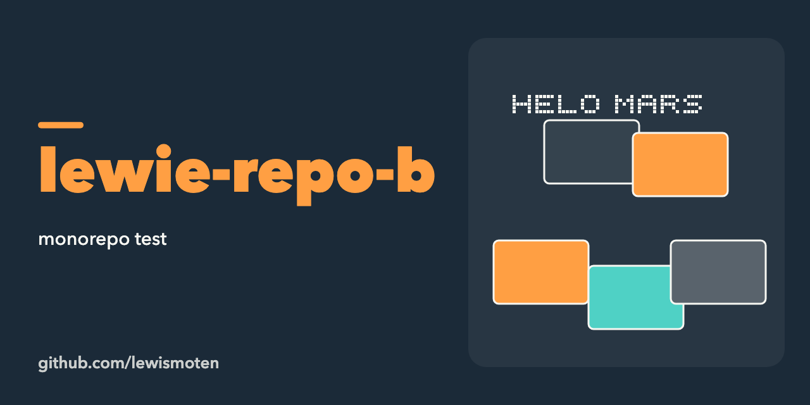

# lewie-repo-b

A monorepo test. The package exports one function, `bar()`, which returns `"HELO MARS"`. It exists to try out repository layout and is not meant for real use.

## License

MIT. See [LICENSE.md](LICENSE.md).
